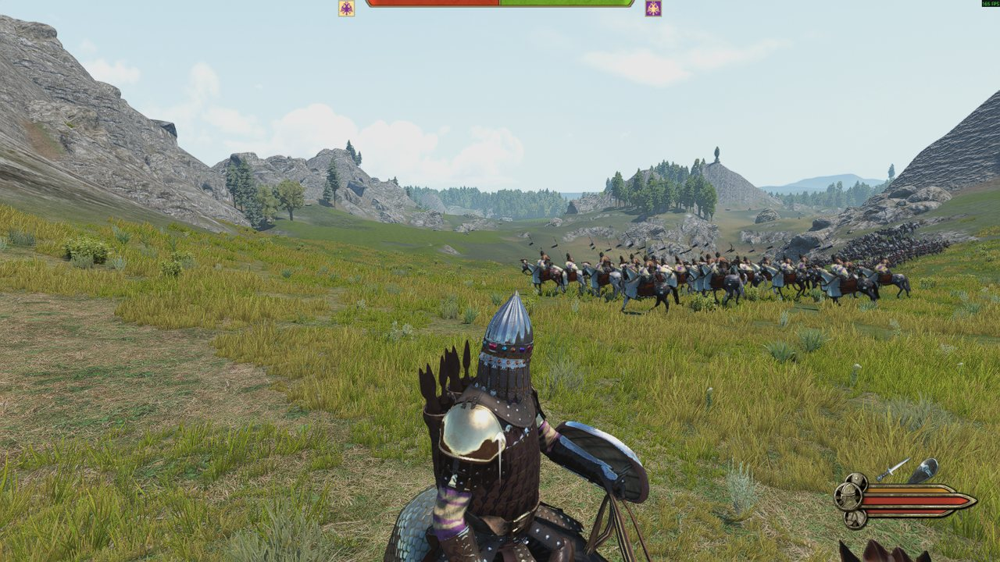
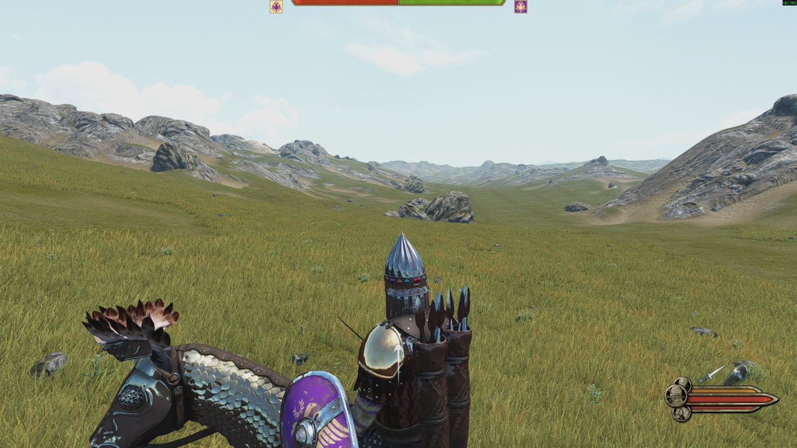
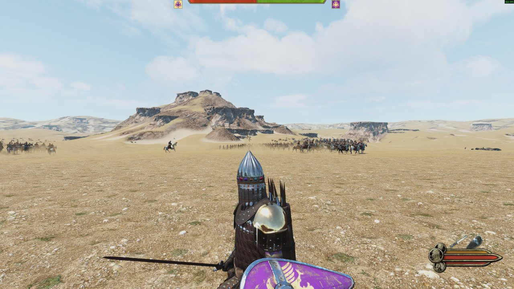

# Bannerlord Editor-Free SDK

The Bannerlord Editor-Free SDK is a set of Python tools for building Mount & Blade II: Bannerlord mods without the
Modding Kit editor.

The tools write the game's file formats directly: asset packages (`.tpac`), runtime caches (`.rdc`) and complete
scenes (terrain, navigation mesh, entities). Input is PNG, FBX, glTF or PSK files, or plain arrays for terrain.
Output is loaded by the game from a regular module.



*A battle map written entirely by the SDK, running in the unmodified game. Generated by
[Procedural Battlefields](https://github.com/theartur2000/bannerlord-procedural-battlefields).*

> [!NOTE]
> The SDK targets Bannerlord v1.4.8.119303 (Steam, Windows, single player). Other game versions are untested.
> This repository contains no game content; everything is read from the local install at run time.

## Why

The Modding Kit editor imports assets one at a time through its interface, which takes seconds to minutes per asset
and has to be done by hand. The SDK processes an asset in seconds and runs unattended, which makes mods with tens of
thousands of assets practical. It was developed for a total conversion with about 34,000 assets.

## Features

- **Asset writers**: textures (BC1, BC2, BC3, BC4, BC5, BC6H, BC7, RGBA8, R8, R16 and half-float formats), materials, static and skinned meshes, skeletons with
  ragdoll physics, skeletal animations, animation clips and their runtime caches.
- **Scene writers**: `scene.xscene`, `terrain.bin` and `navmesh.bin` from height arrays, layer masks and entity
  lists, using a shipped scene as the template for texture layers and atmosphere.
- **Collision bodies**: reads and rewrites every physics shape the game ships byte for byte, and writes new shapes
  made of capsules, spheres, convex hulls and triangle meshes. Hulls and meshes are cooked by the PhysX 4.1.2 cooking
  library the game ships, loaded from Python with ctypes; cooked from their own description, all 16,655 shipped hulls
  and all 16,701 shipped meshes come out byte-identical (402 meshes with the BVH34 tree, 21 with zero material indices).
  Cooked shapes have not been loaded in game yet.
- **Readers for shipped content**: any mesh by name, every battle scene and its rock placement, and the campaign map
  as a height and terrain grid.
- **Custom assets in scenes**: third-party textures, materials and models (PSK or FBX) as terrain layers and
  entities.
- **Validation**: checks for the faults that crash or freeze the game (bone counts, clip name length, clip partners,
  `project.mbproj` registration and others) before the game loads anything.
- **Safe installs**: backup, manifest and one-command revert. Install commands refuse to run while the game is open.
- **Package merging**: combines thousands of small packages into a few. In one mod, 34,000 assets were merged into
  26 packages, reducing package load time from 25.7 s (280 s cold) to 5.6 s.
- **Self-test**: rebuilds the game's own packages and verifies the output is byte-identical.
- **One command line for agents**: `bl` wraps all of the above. Every command prints one JSON object, and every command
  that changes files has a dry run. The same commands are available as MCP tools.
- **Project scaffold**: `bl new` creates a module that builds and deploys as it is, with an unattended test driver.
- **Previews without the game**: a mesh from six sides and a scene from above, as PNG, in about a second.
- **Heightmap import and export**: a playable scene from a greyscale image, and any scene's terrain as an image.
- **Scenes without a restart**: scratch scene slots that can be filled while the game runs.
- **Compatibility report**: `bl compat` names every file format that no longer matches after a game update.
- **Test harness and crash tools**: PowerShell scripts for unattended game runs (`harness/`) and helpers for
  minidumps and Ghidra (`dump/`).

## Getting started

```powershell
pip install -r requirements.txt
bl doctor                                # what the SDK found: game, version, tools
bl compat --quick                        # do the file formats match this game version (reads the install, changes nothing)
bl new MyMod                             # a new module project
cd MyMod
bl build                                 # compiles it against the installed game
bl asset texture rock_d.png              # stage a texture
bl stage verify                          # run the validators
bl install --dry                         # show what would be copied where
```

`bl` is `bl.cmd` (or the `bl` shell script) in the repository root; add the folder to `PATH` or call it by its full
path. It is the same as `python sdk/bl.py`.

## Command line for agents

`bl` is designed to be driven by an AI agent or a script. Every command prints exactly one JSON object
(`{"ok": true, "result": {...}}` or `{"ok": false, "error": "...", "hint": "..."}`), the exit code is 0 or 1, and
every command that changes files accepts `--dry`. `bl commands` returns all commands with a JSON Schema of their
arguments. [docs/AGENTS.md](docs/AGENTS.md) is the guide written for agents.

| Group | Commands |
|---|---|
| Machine | `doctor`, `commands`, `compat` |
| Project | `new`, `build`, `deploy`, `run`, `workshop.config` |
| Assets | `asset.texture`, `asset.material`, `asset.mesh`, `asset.skeleton`, `asset.anim`, `asset.clip`, `stage.list`, `stage.verify`, `install`, `revert`, `status` |
| UI | `ui.sprites` |
| Scenes | `scene.list`, `scene.info`, `scene.entities`, `scene.ground`, `scene.add_entity`, `scene.remove_entities`, `scene.copy`, `scene.check`, `scene.preview`, `scene.heightmap`, `scene.from_heightmap`, `scene.register` |
| Meshes | `mesh.find`, `mesh.info`, `mesh.preview`, `mesh.export`, `physics.info` |
| Campaign map | `worldmap.at`, `worldmap.settlements` |
| Scene slots | `slots.create`, `slots.state`, `slots.fill`, `slots.reset` |
| Running game | `live`, `live.enable` |

The same commands are MCP tools. Register the server with an agent, for example in `.mcp.json`:

```json
{"mcpServers": {"bannerlord": {"command": "python", "args": ["<repo>/sdk/mcp_server.py"]}}}
```

Safety rules built into the command line:

- Nothing is written into the game folder while the game runs or while another session holds the game lock.
- Scenes of the game's own modules are never changed; `scene.copy` makes a working copy.
- `run` starts the game only with `--launch`.
- `workshop.config` writes the file for the game's Workshop uploader and stops there. Uploading is a manual step.

## Requirements

- Python 3.10 or later with `numpy` (`pip install -r requirements.txt`). `Pillow` is required only for image
  output (terrain previews) and for `sdk/assetpack.py`.
- Mount & Blade II: Bannerlord on Windows. The Modding Kit is **not** required.
- For `dump/`: `pip install minidump`. Ghidra and JDK 21 are required only for `RE.java`.
- For `harness/`: PowerShell 5.1 and a small C# component in the module under test (see [Test harness](#test-harness)).
  A project made with `bl new` contains one.
- For `bl build`: the .NET SDK (any version that can build `net472`). `BL_DOTNET` can point at a specific `dotnet.exe`.

## Project status

| Area | Status |
|---|---|
| File formats | Verified by byte-identical round trips against the game's own files (see [Self-test](#self-test)). |
| Scene tools | Verified in the unmodified game: generated battle maps, 200 vs 200 battles, custom textures and models. |
| Asset commands | Pass the self-test. The scripts they were packaged from built a large mod that runs in game; the packaged commands themselves have not yet been run in game. |
| Command line, MCP server, scaffold | Covered by `tests/run_offline.py` (no game needed) and run against an install. Verified in game (2026-10-13, seven sessions): a project made with `bl new` builds, deploys and loads; its test driver runs a Custom Battle unattended and the harness passes; every bridge command answers. |
| Heightmap import | Verified offline (identical heights after export and import, files pass `scene.check`) and in game: a heightmap scene with ground cover loads and holds 200 against 200. |
| Scene slots | Verified in game: a slot filled while the game ran was then loaded for a battle, and slots used in one session were emptied at the next start. |
| Collision bodies | Capsule and sphere bodies made by the SDK verified in game: a ray cast hits the top of the body at the expected height (to the millimetre), with and without a visible mesh. Cooked hull and triangle-mesh bodies load without errors, but the in-game check could not confirm them: the engine's ray casts also miss the shipped triangle-mesh bodies of entities placed in a scene file. |
| Workshop upload file | Written to the format the game's uploader reads. Not verified by an upload. |
| Other game versions | Untested. `bl compat` reports what still matches. |

Details are in [Verification](#verification).

## Scenes

[Procedural Battlefields](https://github.com/theartur2000/bannerlord-procedural-battlefields) is the reference
project for the scene tools. It generates a new battle map for every campaign battle and uses this repository as a
submodule.

| | |
|---|---|
|  |  |
|  |  |

| Module | Role |
|---|---|
| `sdk/scenebuild.py` | Writes a scene folder (`scene.xscene`, `terrain.bin`, `navmesh.bin`) from arrays. |
| `sdk/terraform.py` | Terrain building blocks: noise, warping, erosion, scattering. |
| `sdk/catalog.py` | Measures how shipped maps use each rock and paint each ground layer. |
| `sdk/meshread.py`, `sdk/rockfit.py` | Read a rock's mesh and fit it to the terrain. |
| `sdk/worldmap.py` | Reads the campaign map: height, terrain type and water at any position. |
| `sdk/assetpack.py`, `sdk/psk.py` | Import custom textures and models for use in a scene. |

The map below was built with `sdk/assetpack.py` from Borderlands 2 models and textures only, read from a user-owned
copy of that game:


### Engine behavior

The following engine behavior was established during development. The SDK accounts for all of it; it is listed here
for anyone writing scenes by other means.

- A terrain node requires 16 layer weight slots regardless of the number of layers. With fewer, the game
  intermittently crashes on load.
- A scene folder that did not exist at game start cannot be loaded. An existing folder can be rewritten while the
  game runs. Zero-byte `scene.xscene`, `terrain.bin` and `navmesh.bin` files are sufficient at startup.
- After a scene's first load, its `terrain.bin` remains open until the game exits. A scene can be rewritten before
  its first load in a session, but not after.
- A module's `Assets` folder is read only if the module also has an `AssetSources` folder.
- The terrain shader is cached per module and scene name under `ProgramData`. After changing a scene's layers, the
  cache must be deleted, or the terrain renders black or with the wrong textures.
- A terrain layer without an area map must name it `none`. An empty name renders the terrain black.
- Most shipped rocks are open shells. Shipped maps orient cliff pieces consistently on a slope (yaw = downhill + 90
  degrees) and still leave about a third of the rim exposed, out of view.
- Terrain above a rock's solid surface allows agents to walk beneath the ground.
- A mesh from Unreal Engine, mirrored into Bannerlord's coordinate system, keeps its triangle order.
- In a campaign battle, the game selects the spawn path that best matches the direction of the encounter and
  offsets both armies along it according to the party's position within the map tile.

## Configuration

The SDK reads its paths from environment variables (`sdk/config.py`):

| Variable | Meaning | Default |
|---|---|---|
| `BANNERLORD_DIR` | Game install (contains `bin\` and `Modules\`) | The standard Steam path, if present |
| `BANNERLORD_MODULE_DIR` | Module being built, `<game>\Modules\<YourModule>`. Required by install, revert and pack commands. | None |
| `MODULE_ASSET_SUB` | Sub-folder of the module's `Assets` that holds the SDK's packages | `mymod` |
| `BANNERLORD_SDK_HOME` | Root of all folders the SDK writes to (see [Working folders](#working-folders)) | `%LOCALAPPDATA%\bannerlord-sdk`, else `~/.bannerlord-sdk` |
| `SDK_STAGE_DIR` | Where writers stage output before install | `<SDK home>\stage` |
| `SDK_BACKUP_DIR` | Where install keeps backups and manifests | `<SDK home>\backup` |
| `SDK_LOCK_FILE` | Install, revert and pack commands refuse to run while this lock is held by another owner | `<SDK home>\GAME_LOCK` |

```powershell
$env:BANNERLORD_MODULE_DIR = "C:\Program Files (x86)\Steam\steamapps\common\Mount & Blade II Bannerlord\Modules\MyMod"
python sdk/config.py        # prints the resolved paths
python sdk/selftest.py      # requires only BANNERLORD_DIR
```

Scripts can be run from any folder (`python sdk/tpac.py ...`). Running a script without arguments prints its
commands.

## Working folders

The SDK never writes to the current directory. All output goes under one per-user folder, the SDK home:
`%LOCALAPPDATA%\bannerlord-sdk`, or `~/.bannerlord-sdk` if `LOCALAPPDATA` is not set. `python sdk/config.py` prints
the folders in use.

| Folder under the SDK home | Contents | Written by |
|---|---|---|
| `stage` | Staged packages and caches, `_selftest`, `_native_check`, `_cache` | `sdk/` tools |
| `backup` | Backups of module files replaced by `install`, with manifests (converted game content) | `sdk/install.py`, `sdk/tpac_pack.py` |
| `GAME_LOCK` | The lock file | `harness/game_lock.ps1`, read by `sdk/` |
| `out` | Test run results, logs and moved-aside saves | `harness/` |
| `config_backup` | Copies of the game's launcher and engine configs during a test run | `harness/bannerlord_test_config.ps1` |
| `re_out`, `re_proj` | Ghidra output (decompiled game code) and Ghidra projects (which contain a copy of the game's DLL) | `dump/re.ps1`, `dump/RE.java` |

Individual folders can be relocated with `SDK_STAGE_DIR`, `SDK_BACKUP_DIR`, `SDK_LOCK_FILE`, `SDK_CONFIG_BACKUP`,
`RE_OUT_DIR`, `RE_DECOMP_DIR`, `RE_PROJECT_DIR`, or the `-OutDir` parameter of the harness scripts. Several of these
folders contain copies of game content or code and must be kept outside any repository. The `.gitignore` of this
repository lists the same names as a safeguard.

## Commands

`sdk/install.py` is the main entry point. Writers stage their output in `<SDK home>\stage\<name>` (default `work`),
and `install` copies a stage into the module.

```powershell
python sdk/install.py texture rock_d.png                       # BC1/BC3 by alpha; _n becomes BC5, _s BC1, _h BC4
python sdk/install.py material rock --diffuse rock_d --normal rock_n --skinned
python sdk/install.py skeleton creature.gltf --name creature_skeleton     # max 64 bones, minimal ragdoll; FBX works too
python sdk/install.py mesh creature.fbx --material rock        # skinned bones are named bip01_<name>_<index>
python sdk/install.py anim creature_walk.fbx                   # single-take FBX -> skeleton animation
python sdk/install.py owner "<SDK home>\stage\work\Assets\creature_walk_geo.tpac" --skeleton <skeleton guid>
python sdk/install.py clip creature_walk_clip creature_walk 31 # clip on that animation, 31 frames at 30 fps
python sdk/install.py clip-cache "creature_walk_clip"          # its RuntimeDataCache entry, no editor load needed
python sdk/install.py verify stage                             # validators on the stage
python sdk/install.py install --dry                            # what would be copied where
python sdk/install.py install                                  # backup and manifest, then copy
python sdk/install.py revert                                   # undo the newest install
python sdk/install.py status
```

| Script | Description |
|---|---|
| `sdk/install.py` | stage writers, `verify`, `install`, `revert`, `status`, `inspect` |
| `sdk/tpac.py` | the `.tpac` / `.rdc` reader and writer: textures (all twelve formats the game uses; encoders: BC7 mode 6, BC6H mode 11), materials, animations from FBX, clips, clip caches (every layout the game uses); `texture`, `tex`, `material`, `mtl`, `retex`, `anim`, `clip`, `clip-cache`, `optanim`, `owner`, `anims` |
| `sdk/sdk_mesh.py` | FBX to metamesh packages and vertex-stream caches; `mesh`, `obj` |
| `sdk/sdk_skeleton.py` | skeleton packages from FBX or glTF, Native skeleton readers |
| `sdk/scene.py` | `scene.xscene` and other game XML read and written without changing a byte that was not edited; entities listed, added, moved, removed; `check`, `list` |
| `sdk/terrain.py` | `terrain.bin` reader and writer: heights, normals, layer weights and index maps, physics materials; `info`, `check`, `relief` |
| `sdk/worldmap.py` | the campaign map as data: height field, settlements, the patch of land around a map position; `patch` |
| `sdk/navmesh.py` | `navmesh.bin` reader and writer: vertices, edges, faces with their group, value and flags; `info`, `check` |
| `sdk/terraform.py` | building blocks for making terrain: filters, slope, small relief quilted from donor terrains, layer masks |
| `sdk/catalog.py` | what the installed game offers to build from: its battle scenes by terrain type, their prefabs, and how they place each rock |
| `sdk/scenebuild.py` | a complete scene folder from arrays, with a shipped scene as the template for layers and atmosphere; `edit_layer` changes a layer's textures, detail meshes and flags |
| `sdk/meshread.py` | the geometry of any shipped mesh by name, straight from the game's packages, and its open edges; `info`, `obj`, `index` |
| `sdk/rockfit.py` | fits a rock to the ground from its real shape: least rim in the air, earth banked over the rest, ground raised under a custom model as its collision |
| `sdk/psk.py` | PSK / PSKX static meshes (umodel, Unreal exporters) into the SDK's submesh form; `info` |
| `sdk/assetpack.py` | a stage of custom textures, materials and models for a scene, and its install into a module |
| `sdk/tpac_pack.py` | merge many packages into a few and prove the merge; `scan`, `pack`, `verify`, `install`, `unpack`, `native-check`, `logcheck` |
| `sdk/validate.py` | validators: stage, skeleton, clip, `project.mbproj` registration, monster bones |
| `sdk/clip_partners.py` | the clip partner rule against Native's clips |
| `sdk/ik_hit_bones.py`, `sdk/hit_fit.py` | the hit-IK freeze rule, and hit capsules fitted to a skinned mesh |
| `sdk/tw_formats.py` | engine-exact details (data type versions, cache rules, size trailers) and a second reader |
| `sdk/templates.py`, `sdk/config.py`, `sdk/pngio.py`, `sdk/fbx_bones.py` | templates from Native, paths, PNG, FBX reader |
| `sdk/selftest.py` | the self-test below |
| `sdk/texcodec.py` | block decoders and encoders for BC2, BC6H and BC7, and the uncompressed and half-float formats |
| `sdk/physics.py` | physics shapes (collision bodies): read, write, round trip, build from capsules, spheres, hulls and meshes; `info`, `check`, `rebuild`, `cookcheck`, `cook` |
| `sdk/physx_cook.py` | ctypes binding to the game's `PhysXCooking_64.dll`: cooks convex hulls and triangle meshes as the engine does |
| `sdk/bl.py` | the `bl` command line: every command of the SDK with JSON output and dry runs |
| `sdk/mcp_server.py` | the same commands as MCP tools over stdio |
| `sdk/scaffold.py`, `sdk/scaffold/` | `bl new`: project files and the C# templates (entry point, test driver, scene slots, bridge) |
| `sdk/preview.py` | pictures without the game: a mesh from six sides, a scene from above; `mesh`, `scene` |
| `sdk/heightmap.py` | a scene from a heightmap image and a scene's heights as an image; `export`, `scene` |
| `sdk/slots.py` | scratch scene slots: scene folders that can be filled while the game runs |
| `sdk/bridge.py` | the outside half of the bridge into the running game (`bl live`) |
| `harness/` | PowerShell scripts that drive the game unattended |
| `dump/` | minidump helpers and the headless Ghidra batch script |

## Templates

Two writers patch an existing record instead of building one from scratch. Both read their template from the local
Native module at run time and never write it back.

- **Clips** (`clip`): a plain Native clip record without sound, voice, facial, partner, follow-up or combat
  parameters. On v1.4.8.119303 this resolves to `chicken_run_gait` in `animations_animals`.
- **Materials** (`material`): the head, parameters and alpha reference of a plain Native `pbr_shading` record. On
  v1.4.8.119303 this resolves to `weapons1.lod` in `EmAssetPackages\mat0\materials`. Vertex layout, blend mode and
  shader flags are set by the SDK, so the result does not depend on which record is selected.

`python sdk/templates.py` prints the templates selected on the local install. If a game update changes the record
shape and no template qualifies, the command stops and asks for `--template <package>`: a one-clip package or a
material package written by the editor or by the SDK.

## Self-test

`python sdk/selftest.py` requires only a game install and writes only to `<SDK home>\stage\_selftest`. Reference
output for game v1.4.8.119303 with default settings (about 45 s, condensed):

```
PASS packages   200 of 200 sampled Native packages rebuild byte-identical (18495 items; AssetPackages 50/50, EmAssetPackages 150/150)
PASS textures   42 Native textures (12 formats): record re-pack identical 42, size rule 42, pixel hash rule 27 of 29, cubemap layout 8/8;
                re-encode PSNR min: BC6H 37.3, BC7 39.7, DXT3 43.4 dB, ...; R8, R16, R16G16F, R16G16B16A16F, RGBA8 exact
PASS codecs     29 of 29 checks
PASS caches     297 Native clip caches: size trailer rule 297; 297 read by the SDK, 297 re-pack byte-identical
PASS skeletons  3 of 3 Native skeletons re-pack byte-identical
PASS physics    2922 Native physics shapes in 502 packages: round trip byte-identical 2922, rebuilt from their description 2922;
                cooked with the game's PhysX from their description: hulls 2651 of 2651 identical, meshes 2662 of 2662
PASS synthetic  14 of 14 checks
SUMMARY: 7 PASS, 0 FAIL
```

- `packages`: each sampled Native `.tpac` is parsed and rewritten with the SDK's package writer, and the bytes must
  equal the file. `--full --max-package-mb 100000` covers all of them: 1188 of 1188 (91,394 items, 86 s).
- `textures`: up to four textures with inline pixels per format, for all twelve formats Native uses. The record must
  re-pack byte-identical and the size rule must hold, cubemap faces included. A decoded top mip is re-encoded and must
  decode within a PSNR bound; the uncompressed formats must give back the stored bytes. The pixel-hash rule fails on a
  few BC4 and BC5 maps for an unknown reason, so the check requires 80 percent. Textures that are not tested (over
  12 MB of pixels) are named with counts in the output.
- `codecs`: the BC2, BC6H and BC7 decoders against pinned results on seeded random blocks, and every format the texture
  writer offers written from a synthetic picture and read back. The pins catch changes; correctness of the decoders
  was established separately, against an independent decoder, on tens of thousands of random blocks.
- `caches`: every layout of Native clip caches: with and without a root channel, with and without raw key channels.
- `physics`: up to eight physics shapes per package: decoded and re-encoded byte-identical, rebuilt byte-identical
  from their own description, and every manifold cooked with the game's PhysX library must equal the stored hulls
  (all 8 mirrored copies) and mesh. A made-up hull body and mesh body are cooked, written and read back.
- `synthetic`: a synthetic skeleton, animation, clip, clip cache, texture, material and mesh are written, read back
  and validated. Four planted faults (65 bones, the IK rule, a 64 character clip name, an invalid `project.mbproj`
  id) must each be detected.

## Verification

Verified for game v1.4.8.119303:

- Container and cache formats, textures, materials, skeletons, clip caches and physics shapes round-trip byte for byte
  (see [Self-test](#self-test)). Beyond the self-test sample: all 12,558 Native texture records, 5,892 of 5,893 clip
  caches in Native's animation packages (the one exception uses a different version word), and all 17,451 physics
  shapes of every module. Further results are in the editor-free assets note under
  [Background](#background): 161 of 166 editor textures, 103 of 103 editor clip caches, all 150 Native asset
  packages.
- Output of the packaged commands was compared with the scripts they were packaged from, on a clip, a movement clip,
  two materials, a mesh and an animation. The bytes are identical apart from random ids and the source-path string,
  and the decoded mesh and animation data are identical.
- Two intentional differences from those scripts: the clip record hash is the correct xxh64 (the engine does not
  check it), and texture mips use an area average, which is within one level of the previous output for opaque
  power-of-two textures and differs more for other sizes and for alpha.

Not verified:

- Cooked hull and triangle-mesh bodies colliding in game (see the status table). Their bytes match the game's own cooks.
- UI sprite sheets made with `bl ui.sprites` loading in game.
- Encoder quality beyond one mode: BC7 is written in mode 6 and BC6H in mode 11 only.

- Other game versions. Offsets and layouts may change; addresses in the notes should be treated as stale after a
  game update.
- The packaged asset commands running in game.
- The harness with modules other than the reference project.
- Multiplayer and anti-cheat. The SDK is for single player only.

Workflow-specific conventions: skinned FBX bones must be named `bip01_<name>_<index>`; the ragdoll written by
`skeleton` is a minimal starting point; clip caches are written only for clips with a root position channel.

## Test harness

`harness/` runs the game unattended. It requires a small C# component in the module under test.
[Procedural Battlefields](https://github.com/theartur2000/bannerlord-procedural-battlefields) contains a complete
example in `mod/GenFields/src/AutoTest.cs`.

- The game is launched with `/singleplayer _MODULES_*Native*SandBoxCore*CustomBattle*<YourModule>*_MODULES_`, which
  leaves the launcher's saved mod list untouched.
- `night_test.ps1` writes test words (for example `plain fight quit`) to an autostart file. The module reads the
  file at startup, runs the scenario, writes an end marker (default `AUTOTEST_DONE`) to its log and exits.
- The harness waits for the marker, collects the log lines and Windows crash events of the run, and retries once on
  failure. Video can be recorded through a script passed with `-Record`.
- `bannerlord_test_config.ps1` switches the game to a silent windowed configuration for the run and restores the
  original configuration afterwards.
- `game_lock.ps1` holds a lock file so that two sessions never run the game at the same time. The SDK's install and
  pack commands honor the same lock.
- `dialogs.ps1` answers the three prompts that would stall an unattended run: "enable safe mode" after a crash (No),
  the shader cache notice (OK) and the crash report prompt (No). It sends no other input.
- `player_checks.ps1` runs named checks from a JSON file (`checks.example.json`) and prints PASS and FAIL lines.

```powershell
powershell -ExecutionPolicy Bypass -File harness\night_test.ps1 -Module MyMod -Words "plain fight quit" `
    -LogFile "$env:BANNERLORD_MODULE_DIR\mymod_log.txt" -DryRun       # validates the harness without starting the game
```

The harness stops only the process it started. New files in the save folder are moved aside and reported, never
deleted.

## Crash dumps and reverse engineering

`dump/` contains minidump helpers (`threads.py`, `unwind.py`, `loc.py`, `rd.py`, `huge.py`, `vt.py`) and `RE.java`
with `re.ps1`, a batch script for headless Ghidra. Usage is described in `dump/README.txt`.

> [!WARNING]
> The `RE.java` commands `decomp`, `decompall` and `insnall` write decompiled game code to disk. That output is the
> property of TaleWorlds. Keep it outside any repository and do not commit, publish or share it. `decomp` writes to
> `<SDK home>\re_out\decomp` by default; for `decompall` and `insnall`, pass a path outside any repository.

## Roadmap

The project is planned to grow into a headless Bannerlord editor: scenes, terrain, a bridge into the running engine,
and a single command-line interface that can be driven by AI agents. See [docs/ROADMAP.md](docs/ROADMAP.md).

## Background

The formats and engine rules are documented in the
[universal-modder](https://github.com/rehan-remade/universal-modder) knowledge base:
[editor-free assets](https://github.com/rehan-remade/universal-modder/blob/main/knowledge/techniques/editor-free-bannerlord-assets.md),
[custom races and creatures](https://github.com/rehan-remade/universal-modder/blob/main/knowledge/techniques/bannerlord-custom-races-and-creatures.md),
[native crashes and hangs](https://github.com/rehan-remade/universal-modder/blob/main/knowledge/techniques/bannerlord-native-crashes-and-hangs.md),
[combat, damage and guns](https://github.com/rehan-remade/universal-modder/blob/main/knowledge/techniques/bannerlord-combat-damage-and-guns.md) and
[the Borderlands 2 conversion the SDK originated from](https://github.com/rehan-remade/universal-modder/blob/main/knowledge/games/mount-and-blade-ii-bannerlord/bannerlord-borderlands-2-total-conversion.md).

## Repository layout

```
bl, bl.cmd      the command line (sdk/bl.py)
sdk/            library and command-line tools
tests/          tests that need no game (run on GitHub for every push)
docs/           AGENTS.md, ROADMAP.md, images/
harness/        scripts for unattended game runs
dump/           minidump helpers, RE.java, re.ps1
```

## Acknowledgements

- Mount & Blade II: Bannerlord and the Modding Kit are developed by TaleWorlds Entertainment. This project is not
  affiliated with or endorsed by TaleWorlds. All formats were derived from the files and binaries of a retail
  install.
- [TpacTool](https://github.com/szszss/TpacTool) by szszss demonstrated that `.tpac` is a readable container. The
  reader and writer in this repository are independent implementations.
- LZ4 and xxHash are algorithms by Yann Collet. The implementations in this repository are independent and follow
  the published formats.
- Ghidra, ILSpy and the Python `minidump` package were used for analysis.
- Developed with Claude Code.

## License

The Bannerlord Editor-Free SDK is released under the [MIT License](LICENSE).
